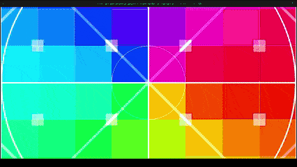
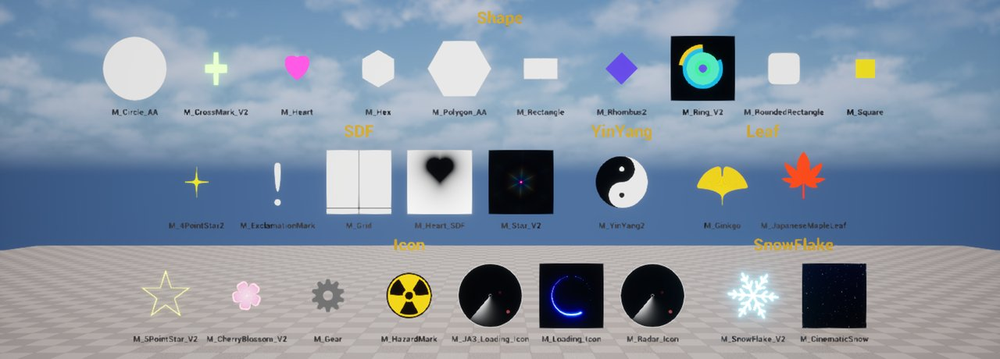
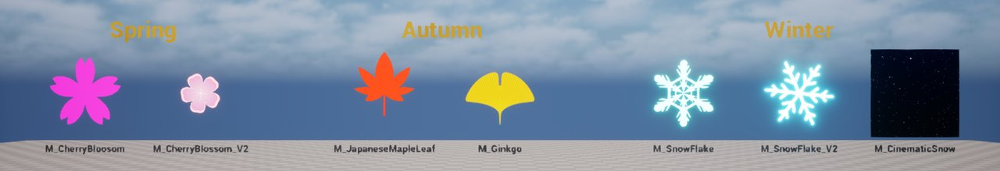
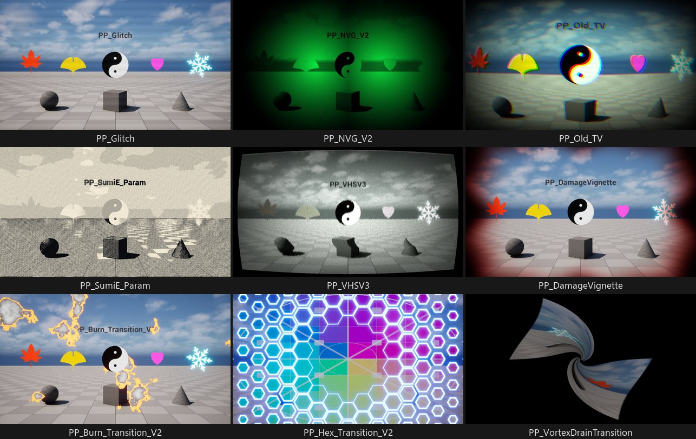
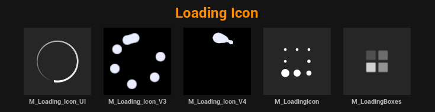

[日本語はこちら](README.ja.md)

# ProceduralDrawingMaterialSamples

## About this Repository

This repository is a collection of Materials and Material Functions created in Unreal Engine 5 (UE5) that draw shapes without using textures.
This project is dedicated to supporting individual developers in the Unreal Engine community.
You are free to use it as long as it does not violate the terms of the [LICENSE](LICENSE) file.

## Features

* **No Textures for Shapes:** Every shape and pattern is calculated inside the material. Textures appear only as sample input (the debug images that transitions switch between, a star image for the outline effect) or as small lookup tables (the 7- and 14-segment displays).
* **Customizable:** Easily adjust colors, shapes, and animations by changing parameters. Many materials come with Material Instances that show variations.
* **Three Ways to Use Them:** Surface materials go on meshes, User Interface materials go into UMG widgets, and Post Process materials apply to the whole screen.
* **Variety of Samples:**
    * Shapes and icons: circles, polygons, stars, hearts, gears, hazard marks, yin-yang
    * Seasonal motifs: cherry blossoms, maple and ginkgo leaves, snowflakes, falling snow
    * Animation: radar, ECG, waves, tunnels, sci-fi rings, warp effects
    * Transitions and dissolves: hex, triangle and rectangle tiles, burn, page curl, ripple, vortex
    * Post process: VHS, old TV, glitch, night vision, halftone, ink painting (sumi-e), speed lines, damage vignette
    * UI: loading icons, gauges, radar chart, 7- and 14-segment displays, potion and liquid

## Showcase

| Radar | Animation |
| :---: | :---: |
|  |  |
| **SnowFlake** | **Transition** |
|  |  |
| **OldTV** | **Others** |
|  |  |
| **PageCurl** | |
|  | |

## Showcase Levels

Open these levels from `Content/Levels` to see the materials side by side.

| Level | What it shows |
| --- | --- |
| `Showcase_Shape` | 27 shapes, SDF shapes, icons, and seasonal motifs |
| `Showcase_Seasons` | 7 seasonal motifs grouped into spring, autumn, and winter |
| `Showcase_PostProcess` | 27 post process effects, one per booth |
| `Showcase_UI_LoadingIcon` | 5 UI loading icons |
| `Showcase` | The original level, with about half of all the materials |

### Showcase_Shape

### Showcase_Seasons

### Showcase_PostProcess

Each booth has its own bounded Post Process Volume, so an effect applies only while the camera is inside that booth. The level opens in front of the first booth: move along the +X axis, or pilot one of the `Cam_<material name>` cameras in the Outliner. Below are 9 of the 27 booths.

### Showcase_UI_LoadingIcon

The icons are placed in a widget (`Content/Widgets/WBP_Showcase_UI_LoadingIcon`) that is added to the screen at runtime. Press Play (PIE) to see them.

## Material Catalog

The project has 177 materials, 91 material functions, and 85 material instances. The [Material Catalog](docs/MaterialCatalog.md) lists all of them, with the domain of each material and the showcase level that displays it.

| Category | Examples | Materials |
| --- | --- | ---: |
| Shapes | circle, polygon, ring, rounded rectangle, star, heart, grid, yin-yang | 24 |
| Icons | star, cherry blossom, gear, hazard mark, radar, loading icons | 9 |
| Seasons | maple and ginkgo leaves, snowflakes, falling snow | 5 |
| Animation & Effects | ECG, waves, tunnels, spirals, hex patterns, sci-fi rings, warp, lens flare, caustics | 40 |
| Dissolve & Fade | rectangle, triangle and hex dissolves, dot and hex fades | 22 |
| Transitions | burn, flip, page curl, ripple, warp, zoom blur | 12 |
| Post Process | VHS, old TV, glitch, night vision, halftone, sumi-e, speed lines, damage vignette, screen transitions | 43 |
| UI | loading icons, gauges, radar chart, 7- and 14-segment displays, potion, outline | 21 |
| Work in Progress | unfinished materials | 1 |

## Reusable Material Functions

The Material Functions are building blocks that you can call from your own materials. Most of them are in `Content/Materials/Function`. Some useful ones:

| Function | What it does |
| --- | --- |
| `MF_DrawCircle` / `MF_DrawCircle_AA` | Circle (`_AA` adds an anti-aliased edge) |
| `MF_DrawPolygon` / `MF_DrawPolygon_AA` | Regular polygon with any number of sides |
| `MF_DrawRoundedRectangle` | Rectangle with rounded corners |
| `MF_DrawRing` | Ring |
| `MF_DrawStar` / `MF_DrawPentagram` | Stars |
| `MF_DrawHeart` | Heart |
| `MF_SDBox` / `MF_Capsule` | Box and capsule shapes from signed distance functions |
| `MF_DrawHexTiling` / `MF_DrawTriangleTiling` | Hexagon and triangle tiling patterns |
| `MF_HalftoneDot` | Halftone dot pattern |
| `MF_N21` | Pseudo-random value from a 2D input |
| `MF_GLSLMod` | GLSL-style `mod` (`x - y * floor(x / y)`), which differs from HLSL `fmod` for negative values |
| `MF_SmoothMin` / `MF_SmoothMax` | Smooth minimum and maximum, for blending distance fields |
| `MF_EaseOutExpo` / `MF_SmootherStep` | Easing curves for animation |
| `MF_PingPong` | Value that moves back and forth |
| `MF_Posterize` | Reduces a value to a fixed number of steps |

`Content/Materials/PostProcess/MaterialFunctions/VHS` holds 18 more functions for retro screen effects, such as CRT curvature, chromatic aberration, scanlines, vignette, and noise.

## Requirements

* Unreal Engine 5.8 or later
    * The assets are saved with 5.8 and cannot be opened in earlier versions.

## How to Use

1.  Clone or download this repository.
2.  Copy the contents of the `Content` folder from this repository into your project's `Content` folder.

## License

This project is licensed under the [MIT License](LICENSE).

## Acknowledgements (in no particular order)

This project was made possible by referencing the following websites and resources. Thank you very much.

* [Drawing a circle with only a shader - Terachur Blog (Japanese)](https://karanokan.info/2019/03/31/post-2465/)
* [Rounded Rectangle Node - Unity Documentation](https://docs.unity3d.com/Packages/com.unity.shadergraph@6.9/manual/Rounded-Rectangle-Node.html)
* [Introduction to Drawing with Unity Shaders - Scrapbox (Japanese)](https://scrapbox.io/Porin-Room/Unity%E3%82%B7%E3%82%A7%E3%83%BC%E3%83%80%E3%83%BC%E3%81%8A%E7%B5%B5%E6%8F%8F%E3%81%8D%E5%85%A5%E9%96%80)
* [shadertoy](https://www.shadertoy.com/)
    * [MlySzw](https://www.shadertoy.com/view/MlySzw)
    * [MlBBWt](https://www.shadertoy.com/view/MlBBWt)
    * [WdVfzt](https://www.shadertoy.com/view/WdVfzt)
    * [4tGfWy](https://shadertoy.com/view/4tGfWy)
* [Eiliram's ArtStation](https://eiliram.artstation.com/projects/KaDLKR)
* [【ShaderGraph】Triangle effect that splits into a grid and expands from the center - Zenn (Japanese)](https://zenn.dev/r_ngtm/books/shadergraph-cookbook/viewer/recipe-triangle-effect)
* [Creating shapes with only UE4 materials - Qiita (Japanese)](https://qiita.com/edo_m18/items/37d8773a5295bc6aba3d)
* [cmzw_ on Twitter](https://twitter.com/cmzw_)
* [【UE5】Creating an arrow with materials - Renard's Blog (Japanese)](https://renard-blog.netlify.app/2023/05/25/_25/)
* [2D Distance Functions - Iñigo Quilez](https://iquilezles.org/articles/distfunctions2d/)

### Textures Used

* [Debug Textures for VFX - Real Time VFX](https://realtimevfx.com/t/debug-textures-for-vfx/7510)
